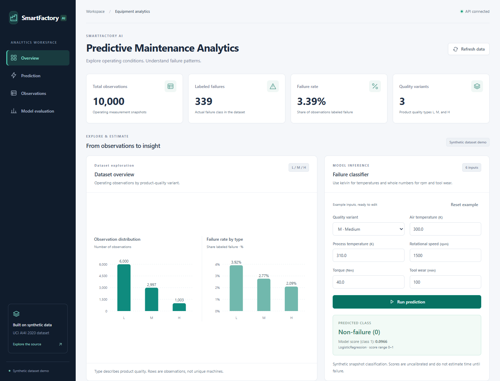
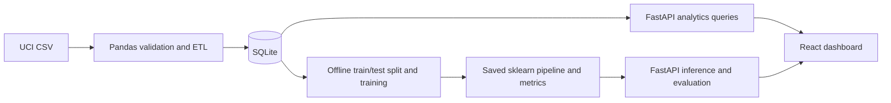

# SmartFactory AI

Explore synthetic equipment observations, query failure patterns with SQL, and
classify operating measurements using a saved machine-learning pipeline.
SmartFactory AI connects a reproducible Python ETL/training workflow to a
FastAPI backend and a responsive React dashboard.

**Live demo:** [Open SmartFactory AI](https://smartfactory-ai-ma2i.onrender.com)



[Mobile screenshot](docs/screenshots/dashboard-mobile.png) ·
[Model evaluation](docs/screenshots/model-evaluation.png) ·
[Demo and interview notes](docs/PORTFOLIO.md) ·
[Verification results](docs/VERIFICATION.md)

## What it does

- Validates 10,000 synthetic observations with Pandas and stores nine selected
  fields in SQLite through an atomic, repeatable ETL command.
- Shows SQL-backed summary cards, quality-type distributions, failure rates,
  and filtered records with server-side pagination.
- Classifies six operating measurements with a saved scikit-learn pipeline.
- Displays measured held-out precision, recall, F1, average precision, and
  a confusion matrix alongside the model's limitations.
- Supports mobile layouts, keyboard navigation, field validation, independent
  loading/error/empty states, and retries when the API becomes available.

This is a portfolio demo using synthetic measurement snapshots. It does not
provide a live sensor feed or estimate time until failure.

## Architecture



The frontend uses React, Vite, Tailwind CSS, and Recharts. The backend uses
FastAPI and Pydantic; SQLite needs no separate database server. Training uses
Pandas, scikit-learn, and joblib. Dependencies are pinned in
[requirements.txt](backend/requirements.txt) and
[package-lock.json](frontend/package-lock.json).

Training runs offline. FastAPI loads the saved pipeline and metrics once at
startup and opens read-only SQLite connections for analytics. React calls the
six API endpoints; it does not contain hard-coded successful results.

## Local setup: VS Code and PowerShell

Install Python, Node.js with npm, and Git. The verified Windows environment is
Python **3.14.7**, Node.js **24.21.0**, and npm **12.2.0**. Use the pinned
dependencies; other runtime versions have not been verified.

For a fresh checkout:

```powershell
git clone https://github.com/tusharXO/SmartFactory-AI.git
cd SmartFactory-AI
code .
```

If this repository is already open, start from its root and skip cloning.
Open **Terminal > New Terminal** in VS Code with PowerShell selected. The
backend and frontend each need their own terminal.

### 1. Prepare data, train, and start the backend

From the repository root in the first terminal:

```powershell
cd backend
if (-not (Test-Path .venv)) { python -m venv .venv }
.\.venv\Scripts\Activate.ps1
python -m pip install -r requirements.txt
python scripts/etl.py --download
python -m scripts.train
python -m uvicorn app.main:app --reload --host 127.0.0.1 --port 8000
```

If you are already in `backend/` with `(.venv)` in the prompt, skip the first
three lines. Do not recreate an active virtual environment.

The ETL downloads the official UCI archive when the local CSV is absent. It
loads **10,000 observations**, including **339 labeled failures**. Training
writes the pipeline to `backend/artifacts/model.joblib` and the measured report
to `backend/artifacts/metrics.json`. The CSV, database, and fitted model are
generated locally and ignored by Git.

Use `python -m scripts.train` in module form so Python resolves the shared
`app` imports. Restart the backend after changing model artifacts.

Open [API documentation](http://127.0.0.1:8000/docs) or
[health status](http://127.0.0.1:8000/api/health). The health response should show
`status: "ok"` and all three readiness fields as `true`. The root API URL `/`
has no route and returns 404.

### 2. Start the frontend

Open a second terminal at the repository root:

```powershell
cd frontend
npm i
npm run dev
```

Open [the dashboard](http://127.0.0.1:5173). Click **Run prediction** to get a
real model result from the editable example inputs.

`npm i` is shorthand for `npm install`. Install dependencies on first setup or
when they change. `npm ci` is also available for a clean install of the exact
lockfile; it is useful for reproducibility and does not update that lockfile.

### Later startups

Keep the existing data, model, and dependencies. From a new terminal at the
repository root, start the backend with:

```powershell
cd backend
.\.venv\Scripts\Activate.ps1
python -m uvicorn app.main:app --reload --host 127.0.0.1 --port 8000
```

In another root terminal, run `cd frontend` and `npm run dev`. Stop each server
with `Ctrl+C` in its terminal.

### API configuration and built preview

The browser defaults to `http://127.0.0.1:8000/api`. To use another address,
copy `frontend/.env.example` to `frontend/.env.local`, set
`VITE_API_BASE_URL`, and restart Vite. This value is public browser
configuration; do not put secrets there. Production builds capture it at
build time.

With the backend running, preview the built app from `frontend/`:

```powershell
npm run build
npm run preview
```

Open `http://127.0.0.1:4173`. FastAPI explicitly allows browser origins on local
development port 5173 and preview port 4173, using either `127.0.0.1` or
`localhost`. Chart code loads separately from the main dashboard bundle.

### Render deployment configuration

The backend CORS allowlist also includes the hosted frontend origin
`https://smartfactory-ai-ma2i.onrender.com`. If the frontend address changes,
update `allow_origins` in `backend/app/main.py` and redeploy the backend.
Origins contain the scheme and hostname, without a path or trailing slash.

For the Render Python Web Service, set **Root Directory** to `backend` and
use this **Build Command** to prepare the generated files that Git ignores:

```bash
python -m pip install -r requirements.txt && python scripts/etl.py --download && python -m scripts.train
```

These commands run in Render's Linux build environment. Set the **Start
Command** to:

```bash
python -m uvicorn app.main:app --host 0.0.0.0 --port $PORT
```

Match the verified runtime with Render's `PYTHON_VERSION=3.14.7` setting.
The application itself has no required backend environment variables.
The database and model are prepared during the build and read during requests;
training is not performed on API startup or for each prediction.

For the frontend Static Site, set **Root Directory** to `frontend`,
**Build Command** to `npm i && npm run build`, **Publish Directory** to `dist`,
and `VITE_API_BASE_URL` to
`https://smartfactory-ai-backend-8zs6.onrender.com/api`. Rebuild the frontend
after changing that environment variable.

Push backend source updates to the branch linked in Render. Automatic deploys
can deploy them; otherwise use **Manual Deploy > Deploy latest commit** on
the backend service. A restart alone does not deploy new source. Check
`/api/health` for `status: "ok"` and all three readiness fields set to `true`,
then reload the dashboard and try a prediction.

## Data and ETL

Source: [AI4I 2020 Predictive Maintenance Dataset, UCI Machine Learning Repository](https://archive.ics.uci.edu/dataset/601/ai4i+2020+predictive+maintenance+dataset)
(2020), [DOI: 10.24432/C5HS5C](https://doi.org/10.24432/C5HS5C), licensed under
[Creative Commons Attribution 4.0 International](https://creativecommons.org/licenses/by/4.0/).
The source contains **synthetic observations**, not 10,000 unique machines.

The downloaded CSV has 14 columns. The loader selects and renames nine fields,
trims product IDs, normalizes quality codes to `L/M/H`, and converts numeric
values while preserving units and the supplied `Machine failure` target.

| Source field | Database field | Use |
| --- | --- | --- |
| `UDI` | `udi` | Record identifier / primary key |
| `Product ID` | `product_id` | Display identifier |
| `Type` | `type` | Model input |
| `Air temperature [K]` | `air_temperature_k` | Model input |
| `Process temperature [K]` | `process_temperature_k` | Model input |
| `Rotational speed [rpm]` | `rotational_speed_rpm` | Model input, whole number |
| `Torque [Nm]` | `torque_nm` | Model input |
| `Tool wear [min]` | `tool_wear_min` | Model input, whole number |
| `Machine failure` | `machine_failure` | Target label, 0 or 1 |

Identifiers are excluded from model inputs. The five failure-mode flags
(`TWF`, `HDF`, `PWF`, `OSF`, `RNF`) are omitted because they describe failure
outcomes and would leak the answer.

| Quality type | Observations | Labeled failures |
| --- | ---: | ---: |
| H | 1,003 | 21 |
| L | 6,000 | 235 |
| M | 2,997 | 83 |
| **Total** | **10,000** | **339 (3.39%)** |

The loader rejects missing/blank required values, duplicate IDs or headers,
unknown categories, invalid ranges, non-finite numbers, and fractional values
in integer fields. It validates before writing and refreshes `observations`
in one SQLite transaction. Rerunning identical input produces the same
records without duplicates; changed input removes stale rows. Failed validation
or writes preserve the previous data.

Default paths are `backend/data/raw/ai4i2020.csv` and
`backend/data/smartfactory.db`. From `backend/`, use `python scripts/etl.py`
to reload the existing CSV, or `--csv PATH --db PATH` for custom paths.
See `python scripts/etl.py --help` for options.

## Model and measured evaluation

The pipeline scales five numeric features with StandardScaler, encodes quality
type with OneHotEncoder, and fits class-balanced logistic regression
(`lbfgs`, `C=1.0`, `max_iter=1000`). A fixed stratified 80/20 split with seed 42
keeps evaluation separate: preprocessing and classifier fitting use only the
training rows. There is no hyperparameter search, threshold tuning, or refit
on the test set. The decision threshold is 0.5.

| Split | Non-failure | Failure | Total |
| --- | ---: | ---: | ---: |
| Training | 7,729 | 271 | 8,000 |
| Held-out test | 1,932 | 68 | 2,000 |

Results from [the saved evaluation report](backend/artifacts/metrics.json):

| Held-out metric, failure as positive class | Result |
| --- | ---: |
| Precision | 14.18% |
| Recall | 82.35% |
| F1 | 24.19% |
| Average precision | 0.3818 |

Confusion matrix: actual classes are rows, predicted classes are columns.

| Actual label | Predicted non-failure (0) | Predicted failure (1) |
| --- | ---: | ---: |
| Non-failure (0) | 1,593 | 339 |
| Failure (1) | 12 | 56 |

The baseline detects **56 of 68 failures**, misses **12**, and raises **339
false alarms**. Most predicted failures are therefore false positives.
Average precision summarizes precision over score thresholds using
recall-weighted precision, rather than trapezoidal area; see
[scikit-learn's definition](https://scikit-learn.org/stable/modules/generated/sklearn.metrics.average_precision_score.html).

The report includes class counts, feature names, split settings, model
parameters, library versions, and a training-data fingerprint. Training can be
repeated with `python -m scripts.train`; `--db` and `--artifacts-dir` select
custom locations. Prediction reuses the entire saved preprocessing/model
pipeline and validates all six inputs with Pydantic.

## API

Base URL: `http://127.0.0.1:8000/api`. Interactive schemas: `/docs`.

| Method | Endpoint | Response |
| --- | --- | --- |
| GET | `/health` | Process status and database/model/metrics readiness |
| GET | `/overview` | Observation count, failure count/rate, quality-type count |
| GET | `/charts` | Type distribution and labeled failure rates by type |
| GET | `/observations` | Filtered, paginated records and matching total |
| GET | `/model-metrics` | Saved held-out evaluation report |
| POST | `/predict` | Predicted class, class-1 model score, model name |

Rates are fractions: `0.0339` means 3.39%. Observation requests support
`limit` (1–100; default 20), `offset` (nonnegative; default 0), `type`
(`L`, `M`, `H`), and `failure` (`0`, `1`). Filters combine with AND; rows are
ordered by `udi`. The response's `total` counts all matching observations.

```powershell
Invoke-RestMethod -Uri 'http://127.0.0.1:8000/api/observations?limit=10&type=M&failure=0'
```

Invalid inputs return HTTP 422 with field details. Missing/unusable resources
return HTTP 503 from the affected endpoint; `/health` stays HTTP 200 with
`status: "degraded"`. An existing empty table returns zero counts and empty
arrays. The dashboard shows missing data as unavailable, with retry controls.

## Verification

From `backend/`, with the virtual environment active:

```powershell
python -m pip check
python -m pytest tests -q
```

From `frontend/`:

```powershell
npm run build
npm run test:e2e
```

Backend tests cover ETL validation and rollback, leakage prevention,
training-only preprocessing, strict inputs, reproducibility, all six API
routes, pagination, missing/empty resources, startup caching, and local CORS.
Browser checks cover real counts, charts, predictions, filtering, pagination,
mobile layout, navigation history, and recovery. Controlled responses simulate
only failure or empty states; successful results use the actual local API.

Browser tests need the generated database and trained model. The runner expects
ports 8000 and 5173; it reuses existing servers or starts its own, stopping
only servers it starts. Windows checks use installed Microsoft Edge headlessly.
Other environments can install Chromium with `npx playwright install chromium`.
Results, clean-setup evidence, environment, and screenshot details are recorded
in [docs/VERIFICATION.md](docs/VERIFICATION.md).

## Limitations and next steps

Evaluation measures held-out synthetic snapshots, not demonstrated performance
in a real factory. Scores are uncalibrated model estimates, not calibrated
real-world failure probabilities. The data does not support remaining-life or
time-to-failure estimates. Low precision and many false alarms limit this
baseline's usefulness for operational alerting.

This portfolio demo has no authentication, live ingestion, or model monitoring.
Possible later work includes a second classifier,
validation-based threshold selection with explicit alert costs, calibration,
and representative real-data evaluation. These are proposals, not completed
features. Render deployment configuration is documented above; check backend
readiness after each deployment before sharing the dashboard.

See [the project plan](PROJECT_PLAN.md) for milestone scope and
[portfolio notes](docs/PORTFOLIO.md) for truthful resume bullets, a 90-second
demo, and interview questions.

## PowerShell troubleshooting

If PowerShell blocks `Activate.ps1` or `npm.ps1` because scripts are disabled,
allow local scripts only for the current terminal session:

```powershell
Set-ExecutionPolicy -Scope Process -ExecutionPolicy RemoteSigned
```

Then rerun activation or `npm`. The setting ends when that terminal closes.
If activation is unavailable, invoke `backend/.venv/Scripts/python.exe`
directly with the same Python arguments from the appropriate working directory.

If a port is already in use, reuse the server already running there or stop it
with `Ctrl+C` in its original terminal. If health is degraded, rerun ETL and
training as needed, then restart the backend. No global execution-policy change
or virtual-environment recreation is needed for routine startups.
